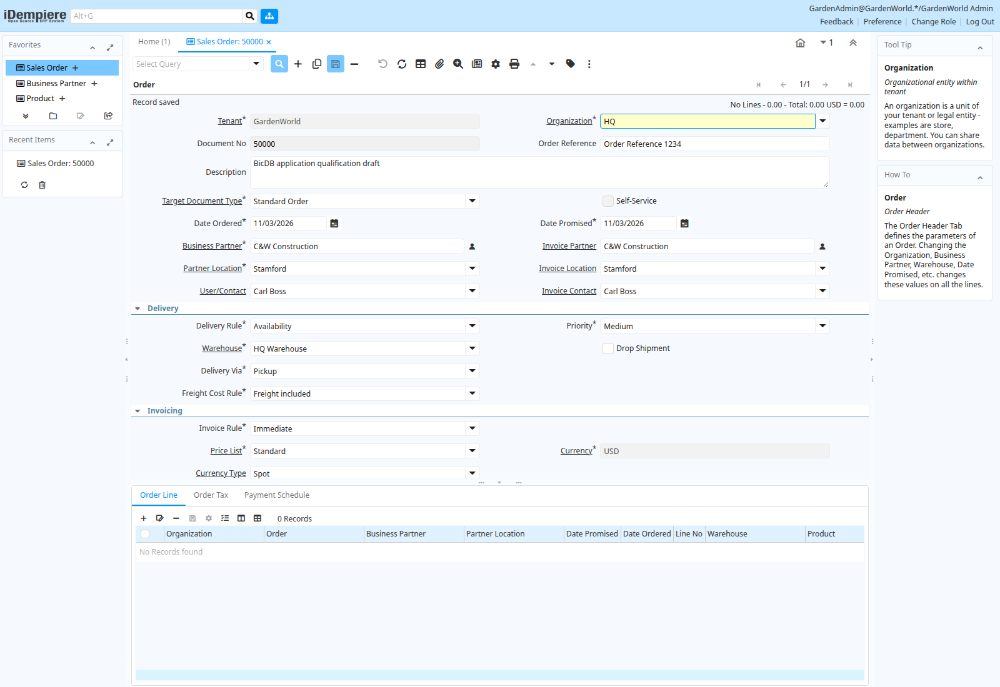

# Sales Order read and draft-save observation

The actual iDempiere Oracle-provider application, using PostgreSQL drivers against
BicDB, now reads an existing sample order and saves a new draft header on a
disposable copy of the migrated Oracle schema. The canonical migration database
was not modified. These observations use the same development binary as the
[view-predicate checkpoint](../sql-view-predicates-2026-11-03/README.md).

Existing order **80002** loads with **three lines**, line total **152.00** and
grand total **161.12 USD**. A separate query against the Oracle reference confirms
those values. This is an existing-order read comparison, not a comparison of
new business transactions executed on both databases.

The application then saved new **Standard Order 50000** for the sample customer
C&W Construction, with the Stamford address and HQ Warehouse. Its description is
`BicDB application qualification draft`. A separate database connection confirms
the committed row, its draft status (`DR`), unprocessed flag (`N`), zero lines
and zero totals. A fresh browser session also retrieves order 50000 by document
number with the saved header values.

The [observation record](validation.json) and
[independent database read](saved-draft-database-read.json) retain the exact
runtime identity and bounded results. iDempiere is an independent
[open-source project](https://github.com/idempiere/idempiere); the screenshots show
its public sample data on the disposable development environment.

Browser automation initially missed customer selection and a document-type
option containing nonbreaking spaces. A separate save attempt correctly refused
an empty mandatory document type. Those harness/field-selection attempts are not
counted as successful writes or database compatibility fixes. Login also produced
an observed connection reset in one attempt; repeated-session reliability and
that transport error remain unqualified.

This does **not** establish line entry, document completion, inventory movement,
invoicing, payment, accounting, posting, restart durability or full application
qualification. The observed missing DBMS_OUTPUT API has a separate
[failing acceptance baseline](../oracle-output-buffer-baseline-2026-11-03/README.md).
No runtime implementation changed in this observation checkpoint. Earlier Rust
validation belongs to its original source checkpoint; it was not rerun or
recounted as a new engine qualification here. No release was published.
