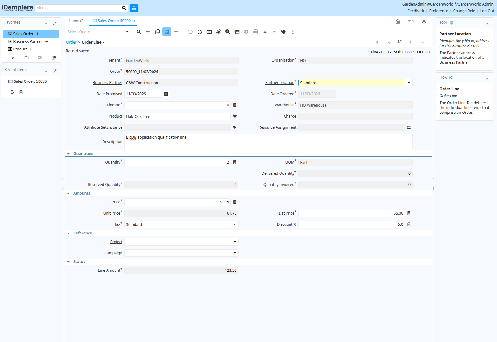
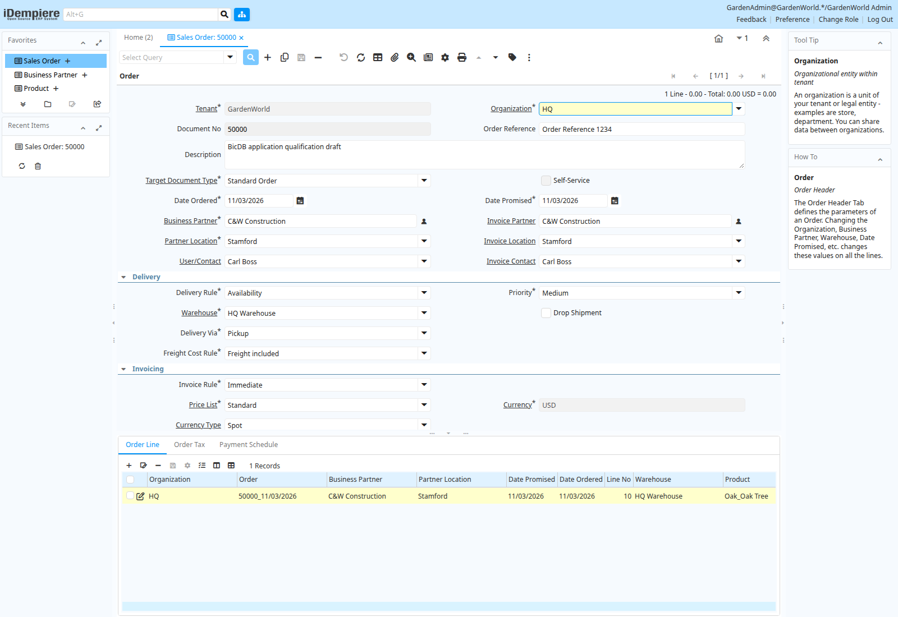

# First saved order line through the Oracle-provider application

The actual release-13 application selected Oak Tree and saved a new line in the
previously created draft order 50000. The line contains product 123, entered and
ordered quantity 2, entered and actual price 61.75, and line net amount 123.50.
An [independent SQL connection](independent-read.json) verified those committed
values. A fresh browser session loaded the parent and its saved line again.
These are public sample records in an isolated qualification database.

This is **partial application progress**. The parent still has TotalLines=0 and
GrandTotal=0, confirmed in both SQL and the fresh browser. The document remains
Drafted/unprocessed. Saving a line does not qualify header/tax propagation,
processing, inventory effects, invoicing or accounting. A matching Oracle
application replay of this newly written order has not been qualified.

## Runtime and reproducibility

The exact runtime identity and checks are in [validation.json](validation.json).
It uses the [aggregate checkpoint](../sql-aggregate-conditionals-2026-11-03/README.md)
development binary, the original Oracle provider and selected PostgreSQL JDBC
transport bridge. All 62 original routine definitions were accepted again;
that count does not prove all 62 execute correctly. The four selected inventory
calls still have two value mismatches, retained in that checkpoint.

The first line automation attempt stopped before saving because its quantity
selector matched a visible numeric input and an auxiliary input. Restricting
that browser selector to the visible numeric field allowed the real application
to save. No database rule, application model or expected result was changed to
accommodate the probe. UI save text alone was not treated as persistence proof.

The existing draft was copied only after its earlier disposable database had
shut down. The canonical migration database was not modified. The later binding
fix under development is not part of this binary's identity or its test counts.
This evidence is not a release, production deployment or complete application
qualification. Full programme work continues beyond definition acceptance and
this first saved line.
