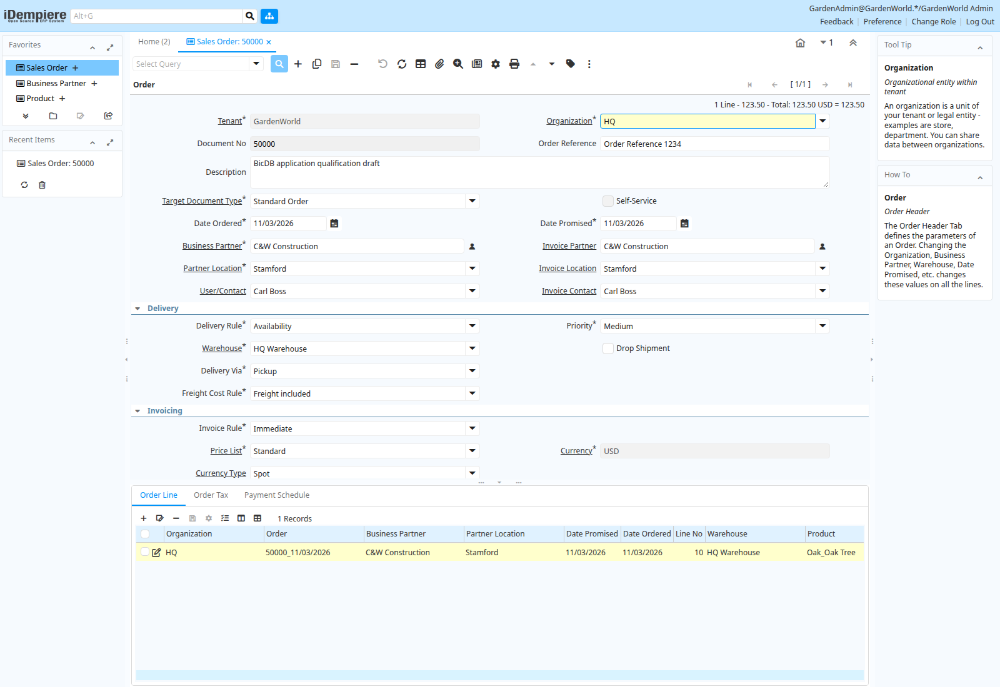

# Saved draft order totals on the Oracle-schema application

The development iDempiere instance runs on BicDB with the imported Oracle schema,
all 62 original routine definitions and PostgreSQL-driver transport. This
checkpoint verifies a draft-order line edit and its automatic header totals,
not the complete application or order-processing workflow.

Through the actual application UI, the existing draft order **50000** had its
Oak Tree line quantity changed from three to **two**. The stored unit price is
**61.75**, line net amount **123.50**, and both header `TotalLines` and `GrandTotal`
are now **123.50**. The prior header totals were zero. No SQL repair of the line
or header amounts was performed. The general
[typed-index visibility correction](../sql-pending-index-visibility-2026-11-03/README.md)
allows the application's transaction to read its pending numeric-key rows when
calculating these totals.

A separate connection [read the committed state](committed-order-read.json).
A subsequent [fresh browser login and document lookup](fresh-browser-read.json)
shows the same total, with no browser page errors:

The selected sample tax is ID 104, whose source rate is zero. The committed tax
query returns no `C_OrderTax` rows. This does not qualify tax selection, nonzero
tax, inclusive tax, compound taxes or full tax-table behavior. The order remains
`DR` (draft), `Processed=N`, with email disabled. This is disposable public-sample
application data; the canonical migration database is separate.

The exact development binary SHA-256 is
`7ef8fd930d27d96649407fa089d8fcdb073f6de94878462a4e6ef8830566948c`,
built from source commit `15735661aefed754823f287451166a29c8d25fa1`.
Its [validation record](../sql-pending-index-visibility-2026-11-03/validation.json)
reports 1,445 passing Rust tests (three existing ignores), 58 Python tests,
24/24 independent Oracle comparisons and 24/24 native PostgreSQL controls for
the bounded index regression. The [four selected unchanged inventory functions](inventory-function-controls.json)
also match the source values 20, 20, 0 and 0 on this binary. These checks do not
establish correctness of every routine or application operation.

Order completion, stock reservation and shipment, invoicing, accounting, rollback,
restart recovery, other modules and a full Oracle-backed application replay
remain unqualified. Source-reference arithmetic for the selected zero-rate tax
is not a full application replay. No published release or production deployment
is claimed.
