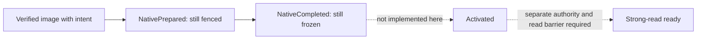

# Native recovery composition: 72 focused component tests

Status: **passed within the stated component scope; production qualification incomplete**.

The executed engine revision is `d52e73726edaedc90d1a5d134f205e99c7c46d0a`, source
version **1.0.471-beta**, on November 11, 2026. This is a private, composed engine
candidate, not merged runtime functionality. The publication version of these
documents does not change that identity. The runtime patch against public
`b0e2498842be7b01e355bb8da1cc249ff16be056` is retained in
[engine.patch.gz](engine.patch.gz), with hashes of all 164 Core Rust source files
in [source-files.json](source-files.json).

There are **72 distinct passing tests in 14 groups**, not 72 additional tests on
top of earlier overlapping receipts. The runner forced compilation from the
intended worktree. It compiled Core in 76 seconds; the entire batch took
202.056 seconds. These durations are build/test observations, **not RTO or
throughput measurements**. Minimum observed available RAM was 22,526,259,200 bytes;
there were no resource pauses or interruptions. Release dependencies were used,
but Core itself used `opt-level=0`, `debug=0`, one build job, incremental disabled,
and two test threads. No production CLI/server binary was built or deployed.

## What changed and what was actually exercised

The new image path consumes an opaque result of actual physical installation,
verification, catalogue adoption and Runtime freeze-owner return. Under an actual
N-owned pin and independently fresh Normal recovery role, it checks the installed
R/H, target-local MVCC sequence, namespace identities and every retained historical
certification checksum against actual native history. It atomically replaces only
that matching install intent with `NativePrepared`. The adopted image base,
irreversible history, recovery nonce and other refusals remain. There is no
intermediate removal of the install refusal to manufacture readiness.

The actual RF3 image test installs an acknowledged R1 record on a behind voter.
Its source-local sequence is B5; the target's sequence advances from B20 to B21.
The target's namespace UUID, row and native history survive cold reopen. Separate
controls deliberately corrupt a compacted certification marker and require a
refusal. Such corruption injection is a negative fixture, not evidence that legal
operations caused that state or that it explains the Azure failure.

The local completion path writes the recovered serving configuration through the
native WAL, then fsyncs `NativeCompleted`, and retains the same physical read pin
and write refusal. Actual pre-write and post-write persistence errors require exact
refusal re-fsync and actual native-state validation before the held proof can be
refreshed. Physical capture epoch and recovered serving epoch remain separate.
This is **completed but frozen**, not an available leader or a strong-read permit.



The TLS tests use real authenticated sockets, filesystem-backed node services and
fresh metadata quorum operations on one shared host/test process. They exercise
Prepare/Status, raw CQ versus physical readiness, distinct-voter counting, and a
clean R0 minority arriving before an actual matching R1 majority. The closed quorum
collector is invoked locally by a trusted test actor. Epoch/leader transitions in
these fixtures are declared metadata preconditions; they are not automatic election
or independent-machine failure experiments.

| Finding | Classification | Evidence / limit |
| --- | --- | --- |
| Nonempty Normal repair reaches actual `NativePrepared` without an unguarded intent-removal gap | Passed | Three current-repair tests, including the unchanged cold reopen control and deliberate marker-conflict refusal |
| Persisted completion keeps writes and historical replay fenced | Passed | Local RF1 closed-quorum tests and both injected persistence boundaries; no activation |
| Authenticated Prepare/Status and distinct matching native-ready quorum | Passed | Six historical/ready TLS tests; shared host, local collector invocation |
| Physical capture epoch remains distinct from recovered serving epoch | Passed | Actual RF1 native-WAL persistence, idempotent retry and strict cold reopen |
| Original Azure four-to-five qualification | Failed, unchanged | This receipt is not a rerun and does not replace the failed-run evidence |
| Repair after an earlier native serving record already exists | Inconclusive | Suspected old-base/configuration interaction; not exercised by this revision's receipt |
| Complete/Activate incoming RPC, activation and a new acknowledged write after recovery | Not tested / not implemented here | No end-to-end recovery-to-serving claim |
| Strong reads and false-not-found behavior during movement | Not tested / not implemented here | No StrongGet endpoint or read-barrier qualification |
| Automatic host/CLI placement and physical four-to-five convergence | Not tested | No VMs provisioned; no current physical RPO/RTO or p50/p95/p99 dataset |
| Index, FTS, queue and original audit/sync/broker effect parity | Not tested | Selected fixture records do not establish those guarantees; original-effects coverage gap remains |
| Joint old/new data configuration activation | Not tested / not implemented here | Same-voter physical domain only |
| Production admission / deployed capability | Not established | Runtime is not merged; no release or deployment qualification |

The original-effects envelope defect is tracked separately in
[issue #148](https://github.com/nikoma/bicdb/issues/148). A replicated final record
is not proof that the original signed audit event, sync effect or broker effect
survives loss of the originating node.

## Exact test groups

| Group | Distinct passes |
| --- | ---: |
| Local native readiness, RF1 closed quorum, serving record and completed-frozen state | 19 |
| Native origin/prefix | 7 |
| Format reader fences | 3 |
| Actual RF3 current-voter image repair, Prepared transition and marker refusal | 3 |
| Runtime authority | 1 |
| Range mutation gates | 9 |
| Durable recovery state | 5 |
| Initial current-voter fencing quorum | 7 |
| Historical and native-ready TLS | 6 |
| Recovery-owned image leases | 3 |
| Actual image catalogue adoption | 5 |
| Historical native Apply | 2 |
| Legacy v1 and v2 catalogue compatibility | 2 |
| **Total** | **72** |

Paths refer to the reconstructed candidate, not to APIs on public `main`:

- `crates/bicdb-core/src/db/native_recovery_ready.rs`
- `crates/bicdb-core/src/db/range_image_native/serving_configuration.rs`
- `crates/bicdb-core/src/distribution_range_consensus/native_ready_prepare.rs`
- `crates/bicdb-core/src/distribution_range_consensus/native_ready_completion.rs`
- `crates/bicdb-core/src/distribution_range_consensus/native_image_ready.rs`
- `crates/bicdb-core/src/distribution_range_image_install/current_repair_tests.rs`
- `crates/bicdb-core/src/distribution_range_recovery/native_ready.rs`
- `crates/bicdb-core/src/distribution_range_recovery/runtime/native_ready.rs`
- `crates/bicdb-core/src/db/range_image_native/rf3_fixture/native_historical_tls.rs`

## Reproduce the evidence check

```sh
python3 docs/evidence/native-recovery-compose-72-2026-11-11/verify.py --repo .
python3 docs/evidence/native-recovery-compose-72-2026-11-11/test_verify.py
```

The first command verifies all retained file hashes, raw test IDs, scope flags,
resource samples and the actual compiler path. It reconstructs the candidate's
engine files from the public base plus the retained patch and checks source hashes.
It **does not rerun Rust tests**. [executed-runner.py](executed-runner.py) records
the actual commands, environment and resource guard. To rerun, reconstruct the
source into a disposable checkout, set the runner's work/output paths, retain its
build flags, and force compilation from that checkout. Do not apply the experimental
engine patch to a production checkout.

The post-run test executable was observed as SHA-256
`14f4ef1f1e304c9662c610bf8bcd1bbcc5d0b3872da99f51f01d505b96a45dc3`.
It occupied a mutable shared test-artifact path and was not archived. This is not a
published release binary or an independently reproducible binary attestation.

Next smallest tests are: (1) retain an actual serving record A while fenced, start
an independently fresh recovery and install image B, preserving the serving epoch
floor; (2) exercise completion/activation through real authenticated participants,
then issue a new write without manually clearing any refusal; (3) test the strong
read barrier and stale-route retries before any new physical expansion campaign.
The existing Azure budget/deadline and teardown outcome are unchanged.
