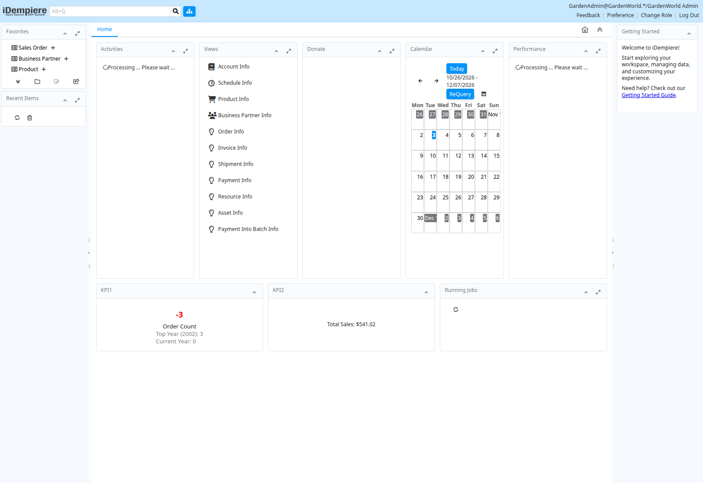

# Text-minimum number formatting

The preview profile implements bounded Oracle `TO_CHAR` text-minimum models:
`TM`, `TM9`, `TME` and their accepted `FM` prefixes. Formatting retains decimal
precision without conversion through floating point. Fixed notation changes to
scientific notation when its representation exceeds 64 characters. NULL input,
NULL format, explicit NULL NLS arguments, numeric conversion and error priority
are compared with the source. The optional NLS argument supports explicit
`NLS_NUMERIC_CHARACTERS` with two valid distinct ASCII characters. This follows
the [Oracle number-format model](https://docs.oracle.com/en/database/oracle/oracle-database/26/sqlrf/Format-Models.html)
with the bounds below.

The [read-only Oracle fixture](../../../examples/oracle/reference/number_text_formats.py)
contains **55** literal, error, NLS and prepared-parameter comparisons. The prior
binary matched **5/55**; the new binary matches **55/55**. These are general
expression rules, independent of application object names. Known literal formats
outside this family continue through the existing formatter. Bound formats keep
TEXT result metadata across preparation and execution.

Compiler version 24 uses language OID 999423. Version 23 retains OID 999422 and its
previous formatting behavior, including when a new routine calls an old routine.
Thirteen reader/reopen checks verify persistence, the old behavior fence, refusal
by older readers, and successful reopening by the current reader. Durable
metadata remains format 5.

## PostgreSQL controls and limits

The [native controls](../../../examples/oracle/reference/postgres_number_text_controls.py)
compare with PostgreSQL 18.4 and separately preserve the preceding BicDB result.
**8/8 preserve the BicDB baseline; only 5/8 match PostgreSQL.** The three existing
gaps concern PostgreSQL literal-letter handling of `TM9`, `TME` and `FMTM9`.
BicDB still reports unsupported formatting for those native calls. They are
reported explicitly, not counted as PostgreSQL parity. Oracle formatting is not
enabled in the native frontend or legacy routine compilers.

This checkpoint does not qualify complete Oracle number formatting, all NLS
settings, linguistic conversion, session decimal-character defaults, non-finite
binary values, national-character inputs or full input coercion. Decimal-text
inputs use the existing default decimal parser. Qualified or quoted user-defined
calls retain their function identity. Complete application execution, business
workflows and production performance require separate evidence.

The detailed [Oracle comparisons](oracle-comparison.json),
[PostgreSQL controls](postgres-controls.json) and [reader checks](reader-comparison.json)
retain individual observations. See [validation.json](validation.json) for source and binary identities,
local regression results and application observations. A development binary is
not a published release or a verified production deployment.

## Application observations

The original Oracle-schema application loaded all 62 stored definitions. Its
first login attempt remained on Processing at the 180-second observation limit.
A subsequent attempt on the same running instance reached the admin desktop:

The desktop shell, calendar and sample KPIs are visible. Activity, performance
and job widgets were still processing in the captured image. This is partial UI
progress, not reliable login or completed workflows. Sequence-counter contention
still produces transaction conflicts during background activity. An independent
synthetic first-row locking probe reproduces a conflict after about six seconds
while the lock owner legitimately holds the row for ten seconds, in both native
and preview profiles. Oracle and PostgreSQL 18.4 both wait the full ten seconds
and return the row in the corresponding source probes. This identifies a concurrency gap; it is not a fixed
or qualified behavior in this checkpoint. Sales-order navigation did not load the window within its separate 240-second
observation limit. Explicit JDBC session isolation commands and complete
business workflows also remain open.

iDempiere is an independent [open-source project](https://github.com/idempiere/idempiere).
The screenshot uses its sample data for compatibility testing. Staging runs use
copies; the canonical migrated database remains unchanged.
