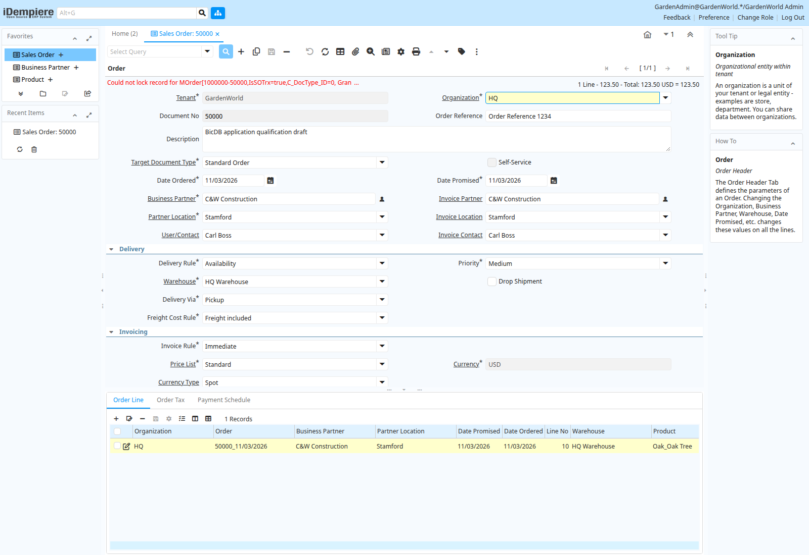

# Oracle row-lock deadline baseline and order-processing dependency

After the [saved draft totals checkpoint](../idempiere-sales-order-totals-2026-11-03/README.md),
the actual Oracle-schema iDempiere instance attempted **Complete** through its
Document Action dialog. The workflow reached the original Oracle provider's
locking read. BicDB rejected its `SELECT ... FOR UPDATE WAIT n` with SQLSTATE
`42601` (`Expected: end of statement, found: "WAIT"`). The application reported
that it could not lock the order. Order completion is **not qualified**.

Separate database connections captured the [before](application-before.json)
and [after](application-after.json) state. The order remains draft, unprocessed,
with email disabled and both totals 123.50. Its line remains quantity two with
zero reserved, delivered and invoiced quantities. No shipment or invoice was
created for this order. The sample workflow records the failure; that is not
successful document completion. These bounded reads do not establish rollback
atomicity for all workflow records or all application tables.

## Executable reference baseline

The independent [deadline fixture](../../../examples/oracle/reference/row_lock_deadlines.py)
creates only a nonce-owned two-column table. It covers uncontended `WAIT 2`,
contended `WAIT 0`, contended `WAIT 1` expiry, owner release during `WAIT 2`, and
explicit cancellation during `WAIT 5`, followed by rollback and connection reuse.
Prepared target reads must execute the actual syntax. Unsupported syntax cannot
be classified as timeout or lock acquisition.

The [baseline](oracle-baseline.json) records Oracle **23.26.3.0.0** and the exact
BicDB development binary SHA-256
`7ef8fd930d27d96649407fa089d8fcdb073f6de94878462a4e6ef8830566948c`,
from source `15735661aefed754823f287451166a29c8d25fa1`.
**Four of five source expectations qualify; zero target cases match.** The target
returns syntax error 42601 for all five, with successful rollback/connection
reuse and no cleanup errors. The executable comparison intentionally returns
nonzero and `success=false`; this is an open-feature baseline, not a passing gate.

The source returns ORA-00054 for both immediate contention and positive deadline
expiry (approximately one second); timing distinguishes them. The fixture also
recognizes ORA-30006 as an expiry diagnostic, without claiming qualification of
other Oracle versions. In the cancellation observation the source instead
reaches its approximately five-second deadline and returns ORA-00054. Both
in-band and default break configurations reproduced that observation. Therefore
cancellation during a timed source wait remains **unqualified**; it is not
silently counted as cancellation success or removed from the acceptance suite.
The published baseline uses the default break configuration.

Oracle documents [the WAIT clause](https://docs.oracle.com/en/database/oracle/oracle-database/26/sqlrf/SELECT.html)
and [ORA-00054 timeout diagnostics](https://docs.oracle.com/en/error-help/db/ora-00054/index.html?r=23ai).
Those documents describe broader syntax than this bounded integer-seconds fixture;
this record does not qualify all documented forms or table/metadata lock waits.

The unchanged native [PostgreSQL lock controls](postgres-controls.json) still
match **3/3** on this exact binary: blocking/latest-row reads, cancellation and
a two-row cycle. The shared CLI keeps its original default runner. Local Python
reference tests pass **25/25**, and JSON/link/diff validation passes. No Rust
source changed for this baseline, so no new engine build is claimed.

## Implementation and qualification still required

- Represent a bounded lock wait explicitly through parsing, lowering, prepared
  Describe/Execute, and runtime execution. Merely removing `WAIT n` would turn a
  bounded wait into an unbounded one and is not an implementation.
- Enforce the deadline on contended row acquisition, preserving cancellation,
  cycle detection, latest-row refresh, statement rollback and prior transaction
  locks. Keep deadlines scoped to the relevant operation without leaking a
  temporary timeout into subsequent statements or pooled sessions.
- Cover zero/positive limits, malformed or unsupported limits, nested query and
  routine forms, named/column locking lists, multiple-row waits and error recovery
  with independent Oracle and native PostgreSQL regressions.
- Resolve or explicitly retain the timed source-cancellation qualification gap;
  existing indefinite-wait cancellation checks do not establish this behavior.
- Rebuild with the memory guard, rerun both reference suites, restart the actual
  application and retry Complete. Then independently qualify stock effects,
  shipment, invoicing, accounting, recovery and the remaining application flows.

The full compatibility programme remains open. This is a development baseline,
not a release, production deployment, or successful iDempiere order completion.
