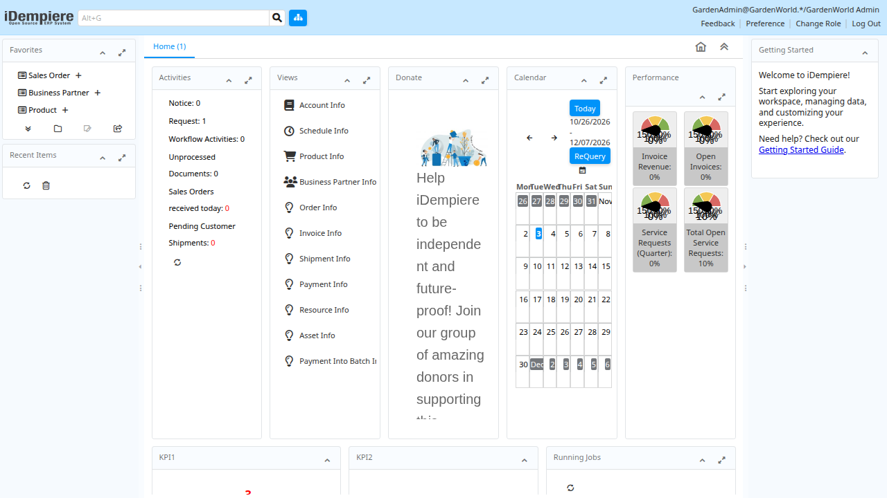

# Startup expression contracts and application observations

SQL concatenation no longer reparses an increasingly deep generated expression
for every operand. A flat expression tree preserves argument order, scalar
subqueries, NULLs and empty strings. **16/16** read-only Oracle comparisons pass.
The three structural regressions cover long chains, repeated lowering and
preservation of qualified calls. An isolated prior-algorithm experiment exceeded
its 10-second limit on fourteen terms; the flat-tree prototype completed and
reparsed in about one millisecond. This is not a production throughput benchmark.

Logical DATE provenance now follows the DML target row into DELETE predicates
and typed builtins. Aliases, fractional days, numeric-plus-date, date subtraction,
NULL offsets, NVL, DECODE and TO_CHAR have source comparisons. SQL TIMESTAMP plus
a numeric day offset produces DATE with fractional seconds discarded. **11/11**
Oracle cases pass; the prior binary matched **2/11**. Ordinary numeric DML retains
its established expressions for index lookup and write repair.

These are general SQL rules. The fixtures contain only synthetic expressions and
owned tables: [concatenation](../../../examples/oracle/reference/sql_concatenation.py)
and [temporal DML](../../../examples/oracle/reference/dml_temporal.py).
Correlated DML, full datetime coercion, all DML syntax and general workload
performance remain unqualified.

## Version and regression evidence

Compiler version 23 uses language OID 999422. The version-22 OID remains 999421.
Legacy routines retain their previous provenance rules; earlier readers refuse
new routines. Earlier readers can execute the equivalent flat view because it
uses their existing scalar functions. Eleven reader/reopen checks pass. Durable
metadata remains format 5.

The final local checks pass **1,408 Rust tests**, with three existing ignores, and
**58 Python tests**. Fifty retained reference reports and the retained collection,
text-pattern, multiset and original-function checks are revalidated against the
same binary. See [validation.json](validation.json) for identities and monitored
resource evidence. GitHub CI and a published release are not claimed.

## Application state

A development candidate reached the GardenWorld Admin desktop using the original
Oracle-schema application on BicDB through the PostgreSQL driver:

The screenshot belongs to the earlier candidate identified separately in the
validation evidence. It shows sample data, not completed business workflows.
iDempiere is an independent [open-source project](https://github.com/idempiere/idempiere);
its interface is shown here for compatibility testing.

The refined candidate passes the SQL contracts, but login remains intermittent
under background activity and sales-order navigation is not qualified. Open
failures include TM9 numeric formatting, sequence-allocation conflicts and an
explicit JDBC isolation-setting command. An isolated real-schema JDBC probe completed 108 reservations with rotating binds
and the expected totals on all three counters. A five-second query limit canceled
some workers; a forty-second limit allowed all twelve to finish. This target-only
check does not qualify full-application concurrency or production performance.
All application runs use disposable copies. The canonical migration snapshot
remains unchanged. Neither this checkpoint nor 62/62 accepted routine definitions
qualifies the complete application or a production deployment.
