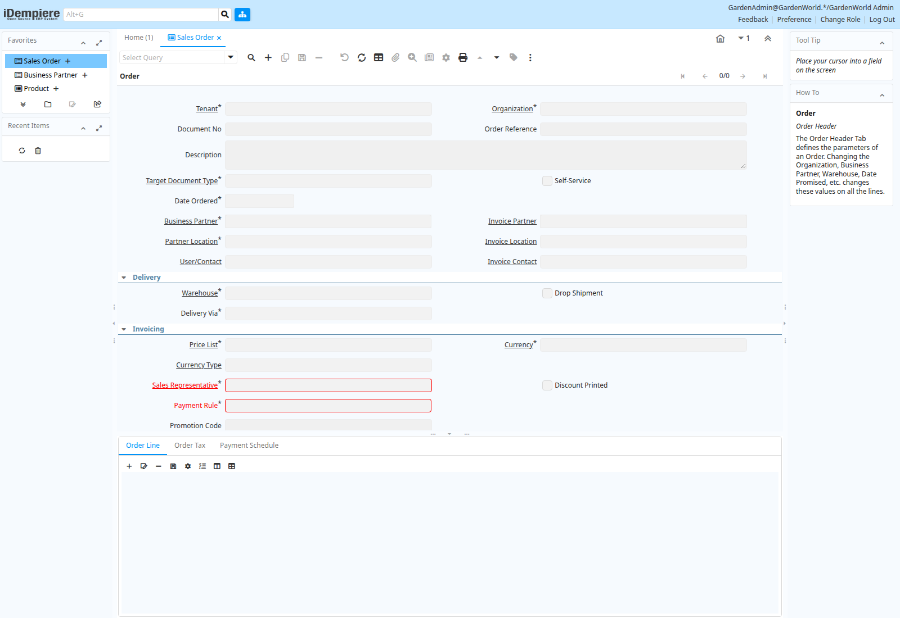

# Selective predicates through ordinary views

Eligible view predicates now follow projected column provenance into the view
query. A filter on a directly projected source column can reach its underlying
index before a wide joined view is materialized. The outer predicate remains
applied. Positional view-column names and table aliases retain their mappings;
quoted and mixed-case identifiers have separate checks.

The optimization admits null-rejecting comparisons, IN lists, BETWEEN and
IS NOT NULL with constant operands and builtin scalar casts. It excludes null-safe
predicates such as IS NULL and disjunctions. Predicates on computed projection
columns remain in the outer query.
Unqualified names are admitted only for a single outer relation. Views with
security barriers, materialization, nested queries/CTEs, row locks, ordering,
limits/offsets, aggregates, windows, stored routines or known volatile builtins retain their
existing execution paths. This is a bounded optimizer improvement, not full
view flattening, function-volatility or Oracle/PostgreSQL conformance.

The view still executes with its existing definer/invoker context and row policies.
No application, schema or table name selects this behavior. The query tree is
rewritten in memory; stored view definitions and metadata format 5 are unchanged.
Compiler version 24 remains current.

The [read-only query comparisons](../../../examples/oracle/reference/view_predicates.py)
use owned synthetic tables and views. They cover aliases, explicit/quoted view
column names, NULLs, joins, aggregate boundaries and prepared parameters. The
Oracle comparison passes **19/19** and PostgreSQL comparison **23/23**. The native
suite additionally covers positional table-column aliases, limits and windows.

## Materialization and application metadata

A repeated synthetic query on the previous and candidate development binaries
returns the same ten rows. The native protocol probe records **600 materialized
rows before and 30 after**, with index probes reduced from 200 to 11. These are
instrumented execution counters on a small fixture, not production throughput or
process-memory measurements. Independent engine tests enforce a materialization
bound in both profiles, with additional semantic-boundary regressions.

On a disposable copy of the migrated Oracle-schema application, the original
Sales Order field view returns **88 rows across 73 columns**, all matching the
Oracle source, including exact normalized values and column names. The prepared
query completed in about **0.74 seconds** in this development observation; the
preceding literal query took about **2.79 seconds**. Cache state and shared-host
load differ, so these timings do not establish a performance SLA. The canonical
migration database remains unchanged.

The local checks pass **1,423 Rust tests**, with three existing ignores, and
**58 Python tests**. Seven focused tests also cover the materialization bound,
quoted/mixed-case aliases and semantic boundaries. Detailed
[Oracle](oracle-comparison.json), [PostgreSQL](postgres-comparison.json) and
[original field-view](application-field-view-comparison.json) observations retain
individual results.

The actual application now opens its Sales Order form:

The image shows the form and child tabs with **0/0 records selected**. It does
not demonstrate a saved or processed order. iDempiere is an independent
[open-source project](https://github.com/idempiere/idempiere); the interface uses
its sample data for compatibility testing. An observed missing
DBMS_OUTPUT.PUT_LINE call and complete business workflows remain open.

See [validation.json](validation.json) for source/binary identities, local checks,
reference reports and observations. Full application workflows, supplied package
APIs and production qualification remain open. A displayed desktop and accepted
routine definitions do not qualify the entire application.
