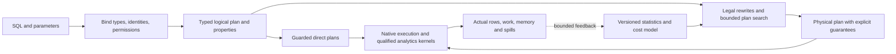

# BicDB query planner: a plan for leading performance and reliability

Status: proposed engineering roadmap, not an implementation or a performance claim.
Source review: `37369c93084bef67e1d3ff250653d5af0141d656`, 2026-11-01.

The objective is a planner that consistently finds good plans for BicDB's actual
workloads, preserves its small-query latency, and stays correct under skew,
concurrency, schema changes, recovery, and resource pressure. Leadership should
be demonstrated on a published workload matrix. No optimizer can promise the
fastest plan for every query, dataset, machine, and planning-time budget.

The recommended order is **correctness and measurement → typed plan contracts →
statistics and costs → access paths and join search → execution improvements →
feedback and adaptation → unified search/analytics planning**. Preserve and reuse
the existing fast paths throughout this work.

## 1. What exists today

This inventory describes inspected code, not a claim that every execution path
has been exhaustively audited.

| Area | Existing foundation | Main opportunity |
| --- | --- | --- |
| Binding and row evaluation | `BoundExpr`, slot rows, column IDs, prepared lookup and assignment templates in [planner.rs](../crates/bicdb-sql/src/planner.rs) | A common typed relational and physical-plan contract; the file name currently covers much more than optimization |
| Access paths | `QueryPlan` / `PlanKind` in [engine.rs](../crates/bicdb-sql/src/engine.rs); PK, PK `IN`, prefix, range, ordered, FTS, JSONB, array, and spatial candidates | Compare paths using consistent startup, total, memory, and physical-property costs |
| Cost selection | [records_plan.rs](../crates/bicdb-sql/src/engine/records_plan.rs) compares candidate costs and uses statistics | Replace scattered coefficients and inconsistent no-statistics fallbacks with calibrated estimates |
| Join planning | [predicates_locators.rs](../crates/bicdb-sql/src/engine/predicates_locators.rs) reorders eligible inner/cross joins, prioritizing index-bound fields, bound terms, and estimated table size | Search combinations of access path, join order, join algorithm, and useful output order |
| Join execution | Dynamic index lookups, inner hash joins, spatial tree joins, and general row joins | Expose actual operator capabilities to the optimizer; extend bounded-memory algorithms where needed |
| Statistics | [core statistics structures](../crates/bicdb-core/src/db.rs), sampled `ANALYZE`, typed widths/MCVs/histograms, range/network statistics, and index counts | Correlation, join-key distributions, freshness, uncertainty, and richer selectivity composition; reviewed extended-statistics catalog relations currently return no rows |
| Planning overhead | Cheap row-count estimates, memoized join orders, bound-plan caches, and per-node templates | Bound cold-start work and cache memory; distinguish semantic invalidation from changes that affect plan quality |
| Instrumentation | Execution/plan traces, limited `EXPLAIN` / `ANALYZE`, counters and regression tests | One versioned operator tree describing the plan actually executed, with per-node estimates and actuals |
| Execution engines | Native row/cell paths with streaming and spill support; a separate [DataFusion analytics integration](../crates/bicdb-analytics/src/lib.rs) | Reuse proven kernels and define explicit engine-boundary costs and semantic guarantees |

Specific issues to measure first:

- Some candidate construction enumerates matching IDs, including FTS/JSONB/array
  paths. Keep such work within a budget and distinguish estimation from execution.
- The row-count fallback can ultimately scan records; lazy count seeding can also
  walk keys. A cold query must not hide an unbounded data walk inside planning.
- The join-order memo keys the input AST and checks full equality. Its documented
  structural reuse is narrower than a general physical-plan cache. Audit legality
  and quality invalidation before extending it.
- Existing `EXPLAIN` handles a limited SELECT subset. Its join summary can label a
  nested-loop plan while executor decisions occur elsewhere. Operator-level truth
  must precede reliable plan-quality comparisons.
- PK `IN` lookup already exists. General membership, nullable membership, and
  subquery planning still deserve a workload-wide investigation.

## 2. Define winning before tuning

Phase P0 freezes hardware profiles, inputs, comparison versions and budgets. The
following are initial engineering targets to ratify against that baseline, not
measured BicDB results.

| Dimension | Proposed acceptance target |
| --- | --- |
| Correctness | Zero unresolved result, visibility, authorization, or write-state mismatches in the qualified corpus; every found bug becomes a minimized regression |
| Existing OLTP | No unexplained p95 latency or throughput regression above 5% on protected point, indexed-update, and short-transaction workloads |
| Complex queries | Target at least 2× geometric-mean improvement over frozen BicDB on the qualified difficult-query corpus; publish every query and the tail, including losses |
| Plan regret | Median ≤1.25× and p95 ≤2× the best **measured eligible alternative on the same BicDB executor**, for queries where alternatives were measured |
| Cardinality | Initial goals: median q-error ≤2 and p95 ≤10 on the held-out estimation corpus; separately report zero-estimate misses, underestimation, join depth and skew |
| Small-query planning | Initial native warm-catalog goals: p95 parse/bind/optimize ≤250 µs for simple point queries; cache-hit validation/binding ≤25 µs |
| Search budget | Starting defaults: up to 20 ms for small join regions, 100 ms for medium analytical regions, 250 ms for large regions; always retain a legal incumbent and report budget exhaustion |
| Resource behavior | Enforce query memory, spill-space, planning-memory and cancellation budgets; no unbounded candidate-ID or join-pair materialization |
| Robustness | Distribution shifts, missing/stale statistics and parameter extremes must not introduce unreviewed catastrophic outliers; investigate any >2× per-query regression before promotion |

Plan regret is measured against the best alternative actually tested, not an
unknowable global optimum. Q-error uses a documented zero convention, such as
`max(actual, estimate, 1) / max(min(actual, estimate), 1)`, with exact-zero failures
reported separately. Include absolute work and row counts so tiny subplans cannot
dominate the score.

Use paired repeated runs, randomized run order and confidence intervals. Separate
planning from execution, first-row from completion latency, warm from cold data,
and planner quality from executor speed. Record timeouts as censored failures;
never remove them or present the timeout threshold as a measured completion time.

## 3. Architecture

Adopt one semantic planning contract, with inexpensive direct planning for simple
queries and a bounded memo-based optimizer for harder queries. A memo stores
equivalent expressions compactly and retains alternatives with different useful
physical properties. [CockroachDB's optimizer design](https://www.cockroachlabs.com/blog/building-cost-based-sql-optimizer/)
is a useful engineering reference for this separation.

Proposed module boundaries, to be confirmed in an architecture decision record:
`binder`, `logical`, `properties`, `rules`, `statistics`, `cardinality`, `cost`,
`memo`, `join_search`, `physical`, `plan_cache`, and `explain`. Start within
`bicdb-sql`; extract a separate crate only if dependency direction or reuse merits it.

Every logical node carries resolved object/column/function identities, output
types and collations, nullability, keys, dependencies, outer references,
volatility/effects, and security barriers. Names remain diagnostic labels.
Every physical candidate declares ordering, parameterization, required columns,
startup/total costs, estimated rows/width, uncertainty, memory, spill capability,
and exactness/recheck requirements. Distribution properties become active only
when a qualified distributed executor exists.

Statistics influence plan choice, never semantic truth: they cannot prove that
a relation is empty, a column is unique, or an exact `COUNT` has a particular value.
Only validated, applicable constraints and sound semantic proofs can do that.

Keep a bounded Pareto frontier where startup time, completion time, ordering and
memory create genuinely different tradeoffs. Reject illegal or over-budget
candidates before ranking them. Calibrate an uncertainty penalty so a slightly
more expensive robust plan can beat a fragile estimate-dependent plan; do not
reduce every workload to one unexamined row-count coefficient.

### P0 — Evidence, correctness oracles and a frozen baseline

**Deliverables**

- Replayable query/parameter traces and dataset manifests. Use separate training,
  validation and held-out workloads, including time-shifted distributions.
- A slow, minimally optimized reference path and test-only controls to choose
  eligible access paths, join orders and algorithms independently.
- Differential testing against a pinned PostgreSQL reference for the supported
  semantic intersection; independent expected-value fixtures for BicDB extensions.
- Metamorphic testing using plan variation, ternary logic partitioning, NoREC-style
  checks, equivalent query forms and schema/index mutations. These complementary
  methods are established in [SQLancer](https://github.com/sqlancer/sqlancer).
- Automatic seed capture, query/data reduction and durable regression fixtures.

Compare typed multisets, duplicates, SQL NULL versus JSON null, required ordering,
and documented error behavior. Do not demand identical unordered output, arbitrary
LIMIT selections, or tie order when SQL does not specify them. Use exact integer
and decimal checks; validate floating-point behavior explicitly rather than
applying a blanket tolerance that could hide errors.

Test nulls, empty inputs, NaNs, overflow, collations, quoted identifiers, composite
keys, lossy indexes, casts, outer/semi/anti joins, scalar subqueries, CTEs, windows,
volatile functions, RLS, savepoints and `FOR UPDATE SKIP LOCKED`. For writes,
compare final state and constraint/trigger effects in isolated database copies.
Crash tests must record transaction IDs and reconcile uncertain outcomes; the
BicDB commit and an external oracle journal cannot atomically commit together.

**Exit gate:** reproduce the retained correctness regressions; show that the
harness catches deliberately injected bad rewrites and stale-cache reuse. All
performance runs carry a passing result/state audit.

### P1 — Typed plan contracts and truthful observability

- Lower existing bound expressions and access paths through typed logical and
  physical adapters. Initially preserve current choices and executors.
- Define transformation preconditions and operator capability contracts. An
  unknown effect, type or visibility guarantee conservatively blocks a rewrite.
- Add a versioned JSON plan tree and human-readable `EXPLAIN`; include supported
  options deliberately rather than silently accepting unused ones.
- Instrument actual operator instances: estimates/actual rows, loops, build/probe
  rows, candidate pairs, residual rechecks, decoded rows/bytes, buffer hits/misses,
  startup/completion time, peak memory, spill bytes and planning work.
- Explain alternative rejection, statistics provenance, cache decision and search
  cutoffs. Preserve privilege checks and redact parameter/statistic values.

`EXPLAIN ANALYZE` executes work. Do not automatically run arbitrary statements to
inspect them. PostgreSQL's [EXPLAIN contract](https://www.postgresql.org/docs/18/sql-explain.html)
provides a familiar interface, while BicDB should expose its own operator metrics.

**Exit gate:** the displayed plan agrees with execution for scan, indexed lookup,
join, aggregate, sort, CTE and subquery fixtures. Results and existing fast-path
behavior remain equivalent; no heavyweight optimizer is added to a cached point lookup.

### P2 — Cardinality estimation and statistics that survive real data

- Extend existing sampled statistics with sample size, schema/type identity,
  data-change counters, freshness and a statistics generation.
- Compose selectivity for equality, ranges, AND/OR, `IN`/`ANY`, NULL tests,
  expressions, joins and groups using the actual type/collation comparison rules.
- Add bounded multicolumn NDV, frequent combinations, functional-dependency and
  expression statistics. Add filtered/index statistics where they improve decisions.
- Estimate join-key heavy hitters, unmatched rows, NULL fractions and fan-out;
  model correlation between a filter and a subsequent join.
- Schedule bounded background refresh by change volume, age and observed estimation
  error. Bound sampling I/O/CPU and write overhead; statistics work must not stall commits.
- Provide conservative estimates and confidence ranges when statistics are absent
  or stale. Remove unbounded planning-time scans and candidate enumeration.
- Treat statistics as disposable optimization metadata across restore/failover;
  stale statistics may affect speed, not results or recovery correctness.

Correlations need explicit treatment; PostgreSQL's
[extended-statistics documentation](https://www.postgresql.org/docs/18/planner-stats.html)
is a practical reference. JOB research identifies estimation error as a major
source of poor plans, supporting this priority ahead of exotic search or learning.
[Leis et al., 2015](https://vldb.org/pvldb/vol9/p204-leis.pdf)

**Exit gate:** estimate and plan-quality reports cover uniform, Zipfian, correlated,
tenant-skewed, NULL-heavy, ascending-key and 10×/100× growth fixtures. Cold planning
has bounded metadata work and never silently materializes an entire table.

### P3 — Calibrated costs and competitive access paths

- Calibrate sequential/random page access, cache hits, row decoding, expression
  evaluation, hash build/probe, sorting, serialization and spill using operator
  microbenchmarks. Include projected width, visibility checks and residual filters.
- Cost startup, full completion and peak memory separately. LIMIT, EXISTS and
  cursor workloads need different tradeoffs from a complete analytical result.
- Compare scans, PK/prefix/range lookups, ordered scans, batched index lookups,
  bitmap/set combinations, late materialization and eligible covering reads.
- Generalize large `IN` and `ANY` to typed membership structures and batched access;
  preserve duplicates in the outer input and NULL-aware `NOT IN` semantics.
- Track which predicates are enforced by an access path and which remain residual.
  Bound probes used for estimation; never cache snapshot-dependent matching rows
  as a reusable plan.
- Cost storage-format conversion and engine crossings. Calibrated models may differ
  by embedded/browser/server profile, without recognizing application names.

**Exit gate:** measured crossover tests select a scan for broad predicates and
an index for selective ones; OR/range/large-list/LIMIT cases stay correct under
deleted rows, pending writes, index rebuilds and residual filtering.

### P4 — Join search with a predictable budget

- Represent join regions as a hypergraph, including predicates that reference
  more than two relations and legality restrictions for non-inner joins.
- Seed search with the existing legal plan and a cheap greedy alternative.
  Apply connected-subgraph dynamic programming to small regions; add bushy plans
  and retain useful ordering/parameterization alternatives.
- Jointly choose join order, scan path, build side, and indexed-loop/hash/merge
  implementation. Add algorithms only when the executor implements their contract.
- Start with a conservative small-region threshold, such as eight relations;
  measure it. For larger regions use bounded beam/iterative-improvement search,
  with hard node, byte and time budgets and a deterministic seed.
- Preserve outer/lateral/semi/anti dependency boundaries. Treat disconnected
  components explicitly; admit cross products only when legal and deliberately costed.
- An exhausted search returns its best legal incumbent. Claim exhaustive search
  only when enumeration actually completes; report the searched space and cutoffs.

Use [Dynamic Programming Strikes Back](https://portal.fis.tum.de/en/publications/dynamic-programming-strikes-back/)
and [the 2025 complete-join-search work](https://db.in.tum.de/~birler/papers/joinspace.pdf)
to inform the enumerator and legality model, with executable local proofs for the
implemented subset.

**Exit gate:** compare search with exhaustive eligible enumeration on small graphs;
exercise chains, stars, cycles, cliques, disconnected components, outer joins and
lateral references. Large graphs return valid plans inside configured budgets.

### P5 — Relational rewrites and the operators to exploit them

Maintain a rule registry: preconditions, changed properties, test generator,
counterexamples, rule version and a way to disable that rule for diagnosis.

- Predicate/projection pushdown; constant propagation and safe expression folding.
- EXISTS/IN decorrelation into semi/mark joins; nullable anti joins for `NOT IN`;
  scalar decorrelation with the required multiple-row error check.
- CTE inlining/materialization decisions, common subexpressions and subquery
  memoization only where effects and correlation permit reuse.
- Join elimination and outer-to-inner conversion only with applicable proofs.
  Foreign-key existence alone is insufficient under deferred constraints, nullable
  keys or row-level visibility restrictions.
- Aggregate/filter pushdown, partial aggregation, streaming groups, DISTINCT,
  window/order reuse and Top-K, preserving each operator's SQL semantics.
- Vectorized typed expression kernels and late decoding; reuse current cell-row
  work. Add batched index joins, merge joins, partitioned/spillable hash joins,
  bounded-memory aggregation/sort, and skew handling as measured needs justify them.

Function volatility and security barriers constrain rewrites. Resolve function
identity before folding; unknown functions cannot be assumed pure.
[PostgreSQL volatility categories](https://www.postgresql.org/docs/18/xfunc-volatility.html)
are a useful compatibility reference.

**Exit gate:** every rule passes differential tests against the reference path,
including under forced alternative algorithms, forced spill, cancellation and
injected I/O failures. Executor gains and planner-choice gains are reported separately.

### P6 — Cache correctness, parameter sensitivity and controlled adaptation

- Separate parsed/bound-template reuse from costed physical-plan reuse and from
  execution state. Bound caches by bytes as well as entry count, with eviction metrics.
- Key or guard by database identity, resolved object dependencies, types/collations,
  search path, role/RLS/security context, relevant settings and optimizer version.
  Invalidate correctly after DDL, privilege/function changes, restore and failover.
  Do not invalidate every plan on every ordinary data commit.
- Track statistics generations separately for plan-quality refresh. Retain full
  key equality checks so hash collisions cannot serve the wrong query.
- Compare generic and parameter-specific plans for skewed predicates. Cap plan
  variants; use selectivity classes and feedback, with hysteresis against thrashing.
  PostgreSQL's [prepared-plan behavior](https://www.postgresql.org/docs/18/sql-prepare.html)
  is a useful reference, not a requirement to duplicate its heuristics.
- Feed bounded per-operator observations into future estimates. Runtime filters
  must have no false negatives and remain advisory to exact evaluation.
- Start adaptation with safe decisions such as hash build-side choice before
  output. Replan only unconsumed, effect-free regions at explicit materialization
  boundaries while preserving the snapshot and produced rows. Never replay
  arbitrary writes or restart a statement after partially returning its result.
- Make admission estimates advisory; enforce actual memory, time, fan-out and
  spill limits at runtime even when estimates are badly wrong.

**Exit gate:** the same prepared statement remains correct and avoids catastrophic
plans across rare/common values, NULLs, parameter type changes, RLS/role switches,
statistics refreshes, schema changes and recovery. Feedback state stays bounded.

### P7 — BicDB's differentiator: one optimizer across capabilities

- Provide capability and selectivity/cost interfaces for B-tree, FTS, JSONB/array,
  spatial and vector access. Compare filter-first versus search-first plans.
- Recheck lossy candidates under current visibility and RLS. LIMIT must count
  eligible visible matches, not merely index candidates retrieved.
- Approximate vector search requires an explicit quality contract; it cannot
  silently replace exact SQL nearest-neighbor semantics.
- Cost native versus qualified DataFusion analytics execution, including conversion,
  snapshot freshness, types, collation, memory and spill. A shared logical contract
  does not imply that the two engines already have interchangeable semantics.
- Substitute OLAP cubes/materialized results only when grain, aggregate algebra,
  NULL/DISTINCT/FILTER behavior, visibility and watermark/tail completeness prove
  equivalence for the query's snapshot.
- Reuse safe compiled templates for live queries, model evaluation/fan-out cost,
  and validate incremental updates against complete recomputation. Enforce fairness
  and circuit breakers without sharing private tenant state.
- Add distributed locality, exchanges and network costing after the underlying
  routing, snapshot and fencing contracts are qualified. A cheap remote read may
  not violate an explicit consistency/staleness bound.

**Exit gate:** mixed relational/search queries and incremental results match exact
recomputation through updates, deletes, index rebuilds and lagging derived data.

## 4. Workload and experiment matrix

Use a versioned, replayable corpus rather than one showcase application:

- Point reads, unique/prefix/range access, short writes and procedure-heavy OLTP.
- Rails Team Board and retained ORM/application traces; available GitLab and
  Oracle/iDempiere fixtures with their actual qualification boundary recorded.
- JOB and analytical workloads derived from TPC-H, accurately labeled rather than
  presented as certified TPC results; joins from 2 to 100 relations.
- Skewed tenants, viral hot keys, overlapping ranges, correlated filters, changing
  distributions, large IN lists, JSONB/arrays, and mixed search/vector/spatial queries.
- Missing/fresh/stale statistics; index present/absent/rebuilding; warm/cold caches;
  small/large memory budgets; concurrent writers and competing analytical queries.
- Server, embedded and browser/Wasm profiles. Browser planning must not require
  native threads, a JIT, network access, or the full server optimizer footprint.

Compare a frozen BicDB baseline, each enabled optimizer tier, and pinned external
engines on supported equivalent workloads. PostgreSQL is the primary SQL-semantics
reference; DuckDB is an additional analytical performance reference where semantics
match. Separate schema import, SQL replay and complete application workflows.

Every retained run includes source/binary/configuration hashes, dataset generator
and snapshot identity, seeds, compiler settings, durability settings, hardware,
correctness receipts, full timings, memory/spill measurements and failure details.
Use dedicated isolated benchmark machines; do not benchmark against live services.
Historical aborted or invalidated runs in the performance ledgers are not baselines.

## 5. Rollout and regression policy

1. Add typed adapters and plan-only shadow comparison behind diagnostic flags.
2. Enable new paths by independently qualified operator/query class. Keep a legal
   legacy fallback until the replacement has equivalent coverage and evidence.
3. Execute differential shadow queries only in isolated fixtures or explicitly
   authorized, effect-free read workloads on the same snapshot. A SELECT with
   locks or volatile/externally visible functions is not automatically safe to replay.
4. Promote on correctness, bounded planning/execution resources, and paired
   performance evidence. Do not trade a correctness failure for an average speedup.
5. Keep operator/rule-level rollback controls and report which implementation ran.
   Cancellation, authorization and resource-limit errors must not be swallowed as
   a reason to retry through a less restricted executor.
6. Run focused tests, affected package suites, platform/pgwire/application contracts,
   and supported build profiles. Merge verified increments to `main`, retain CI
   evidence and delete only the increment's merged temporary branches/worktrees.

CI tiers: fast deterministic correctness on each change; larger randomized and
distribution-drift tests nightly; full alternative-plan, application and fault
campaigns before releases. Controlled performance runners provide comparison
data; noisy shared CI provides functional coverage rather than speed claims.

## 6. Execution sequence and staffing

Initial planning ranges assume four experienced engineers, review capacity and
dedicated benchmark hardware. P0 must revise them using measured integration work.

| Period | Main output | Gate |
| --- | --- | --- |
| Weeks 1–2 | P0 corpus/oracles, architecture ADRs, baseline and counterfactual plan controls | Correctness harness catches injected errors; scope and SLOs ratified |
| Weeks 3–6 | P1 adapters/EXPLAIN; P2 statistics and P3 cost/access work begin | Observable actual plans; no point-path regression |
| Weeks 7–12 | P2/P3 complete first slice; P4 join search; first P5 rules/operators | Measured gains on held-out joins and membership queries; bounded search |
| Weeks 13–18 | P5 coverage/spill, P6 cache and parameter handling | Stale-statistics, skew, memory and recovery gates pass |
| Weeks 19–24 | Core candidate hardening and qualified P7 slices | Full correctness/application audit and repeatable public performance report |
| Following 6–12 month program | Broader P7, larger search spaces, advanced adaptive strategies and research | Leadership claims only for benchmark slices with retained comparative evidence |

Suggested workstreams: optimizer/IR and search; statistics/cost/cache; executor/
storage integration; correctness/benchmarks/application verification. Require
cross-review of SQL semantics and security-sensitive transformations. These are
staffing roles, not authorization to start additional agents or implementation now.

The first useful improvements should be independently shippable within 2–4 weeks.
A core candidate in 16–24 weeks is a planning estimate, not a deadline guarantee.
Broad performance leadership remains an ongoing measured engineering program.

## 7. First six reviewable increments

- [ ] **QP-001:** baseline corpus, isolated oracle harness, deterministic result
  comparison, failure reducer, and experiment manifest format.
- [ ] **QP-002:** versioned actual-plan JSON and operator counters, including
  planning probes, with permission/redaction tests.
- [ ] **QP-003:** typed logical/physical adapters for current PK/index/scan plans,
  explicit residual/effect/visibility properties and unchanged executor behavior.
- [ ] **QP-004:** bounded selectivity/statistics interface, freshness and cost
  calibration; stop planning-time unbounded data enumeration in the migrated paths.
- [ ] **QP-005:** joint scan/join selection for a restricted inner-join region,
  small-graph exhaustive oracle and bounded-search fallback.
- [ ] **QP-006:** generic typed membership and parameter-sensitive access planning,
  including NULL/NOT IN, duplicates, batching, skew and cache-invalidation tests.

Do not make every later feature wait on a complete rewrite. Operators, statistics
and correctness instrumentation can land behind current execution paths while the
new optimizer covers an expanding, explicitly qualified subset.

Advanced learned cardinality/cost models, equality-saturation experiments,
diamond/robust join techniques and learned search ranking belong in an offline
research track after the measured baseline exists. They select among legal plans;
they do not define SQL semantics. No opaque model or online LLM is required to
execute an ordinary query, and no workload-name or fixture-specific production
shortcut is acceptable.
